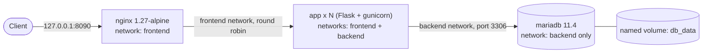

# Docker Compose and Multi-Container Orchestration 

A three-tier app run with Docker Compose. Nginx is the reverse proxy, the Flask app is built from the Part 5 Dockerfile, and MariaDB stores the data in a named volume.

## Architecture

- Only Nginx publishes a port, and only on 127.0.0.1.
- Nginx and the database share no network, so Nginx cannot reach the database.
- The app joins both networks and is the only service that talks to the database.

## Files

- `compose.yaml`: the production setup
- `compose.override.yaml`: dev differences (bind mount, reload, debug logging)
- `.env.example`: template for the real `.env`, which is not committed
- `app/`: Flask app, requirements and Dockerfile
- `nginx/default.conf`: reverse proxy and load balancing config

## How to run

1. Copy the template and set real values: `cp .env.example .env`
2. Start production mode: `docker compose -f compose.yaml up -d --build`
3. Start dev mode instead: `docker compose up -d` (the override file loads automatically)
4. Check status: `docker compose ps`
5. Stop and keep data: `docker compose down`
6. Stop and delete the database volume: `docker compose down -v` (destroys data)

## How to test

- Request: `curl -s http://127.0.0.1:8090/`
- Load balancing: `docker compose up -d --scale app=3`, then `docker compose exec nginx nginx -s reload`, then `curl -s "http://127.0.0.1:8090/?n=[1-12]"`. The `served_by` value rotates between replicas.
- Network isolation: `docker compose exec nginx ping -c 2 db` must fail.
- Persistence: run `docker compose down`, then `docker compose up -d`. The `total_visits` count continues.
- Database failure: `sudo kill -9 $(docker inspect -f '{{.State.Pid}}' compose-lab-db-1)`. The app returns 503 until the database restarts.
- Replica failure: `sudo kill -9 $(docker inspect -f '{{.State.Pid}}' compose-lab-app-2)`. Requests still return 200.

## Troubleshooting

- `port is already allocated`: change `HTTP_PORT` in `.env`.
- `no configuration file provided`: run the command inside the `compose-lab` folder.
- App exits with a KeyError: `.env` is missing or a variable is empty. Check `docker compose logs app`.
- Database stays in `starting`: the first start takes about 30 seconds. Check `docker compose logs db`.
- Access denied for the app user: database passwords are set only when the volume is first created. Use `docker compose down -v` once in development.
- Nginx returns 502 after scaling or restarting replicas: run `docker compose exec nginx nginx -s reload`.
- A command prints `Killed`: the server is out of memory. Stop other containers.
- Permission denied in dev mode: run `chmod -R a+rX app`.
